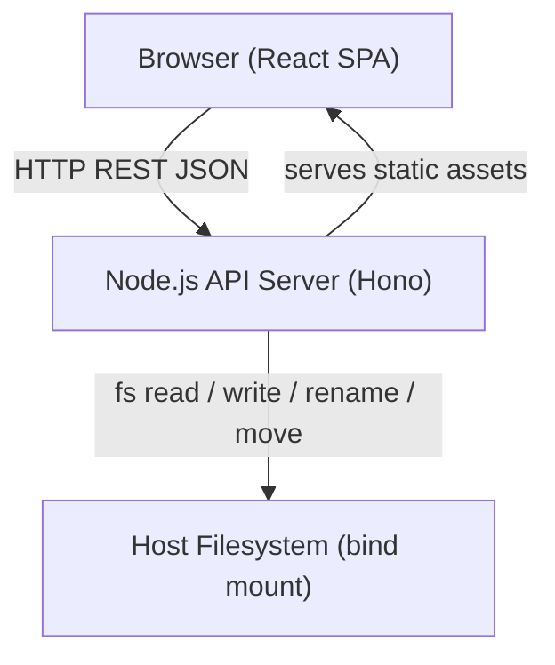
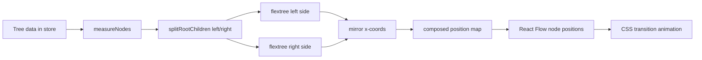

# Design Document — Maplora

## Overview

Maplora is a self-hosted, single-user mind mapping web application that stores all data as JSON files on the host filesystem. There is no authentication, no database, and no cloud dependency. The application runs inside a single Docker container and is accessed through a standard web browser.

This document describes the technical architecture, technology choices, data model, algorithms, and testing strategy for building Maplora.

---

## Architecture

### Overall shape

Maplora follows a **thick-client SPA with thin REST API server** architecture.

The browser owns all business logic: layout computation, undo/redo stack, canvas rendering, and validation. The server is a thin file-management layer — its only responsibilities are reading and writing Map Files on disk and enforcing atomic writes and stale-revision checks. This split is appropriate because there is exactly one user, no server-side session state, and no need for access control.



**Single container, single process**: the Node.js server both serves the compiled React bundle as static files and handles API requests. This avoids a separate Nginx or static-file container and keeps the deployment footprint minimal.

### Deployment topology

```
Host machine
└── Docker container (node:22-alpine)
    ├── /app          — compiled app (immutable)
    ├── /data         — bind mount → DATA_DIR on host
    │   ├── {mapId}.json
    │   └── _trash/
    │       └── {mapId}.json
    └── server process
        ├── GET  /api/maps           → reads /data/*.json
        ├── POST /api/maps           → writes /data/{id}.json
        ├── ...
        └── GET  /*                  → serves /app/dist/index.html
```

---

## Technology Stack

### Frontend

| Concern | Choice | Rationale |
|---|---|---|
| Framework | **React 18** + TypeScript | Mature, wide ecosystem, excellent TypeScript support, large pool of compatible libraries |
| Build tool | **Vite** | Fast dev server and build, minimal config, native ESM |
| Routing | **React Router v6** | File-based routing pattern, lightweight |
| State | **Zustand** | Minimal boilerplate; sufficient for a single-user app with no server-side sync |
| Canvas / diagram | **@xyflow/react** (React Flow) with **SVG** edges | Handles pan/zoom/selection/drag out of the box; nodes are React components so HTML + CSS styling is trivial; SVG edges scale at all zoom levels without blurriness |
| Layout algorithm | **Custom bilateral Reingold-Tilford** (using **d3-flextree** for per-side subtrees) | Handles variable node sizes, O(n) time, well-understood |
| Animation | **CSS transitions** on `transform: translate()` | Smooth, GPU-accelerated, no JS animation library needed |
| PNG export | **html-to-image** | Client-side DOM-to-canvas-to-PNG; no server involvement |
| Styling | **Tailwind CSS v4** | Utility-first, minimal runtime, easy theming via CSS custom properties |

**Alternatives considered:**

- *D3 directly* (without React Flow): more control but requires implementing pan/zoom, hit-testing, and selection from scratch. Not justified for a single-user app.
- *Canvas API*: faster at very large node counts but loses native HTML/CSS for node content, complicates accessibility and text editing. At 500 nodes (the stated performance target), SVG with React Flow performs well.
- *Svelte / Vue*: valid choices but React's ecosystem depth is a better fit for the interactive editor complexity.

### Backend

| Concern | Choice | Rationale |
|---|---|---|
| Runtime | **Node.js 22 LTS** | Same language as frontend (TypeScript throughout), excellent `fs/promises` support, small Docker base image |
| Framework | **Hono** | Minimal, first-class TypeScript support, faster than Express at comparable complexity, no magic |
| Validation | **Zod** | Shares schema definitions between server validation and TypeScript types; used for both API input validation and Map File schema validation |
| File I/O | Node built-in `fs/promises` + `node:path` | No extra abstraction needed for file-based persistence |

**Alternatives considered:**

- *Express*: well-known but ships no built-in TypeScript support and is slower.
- *Fastify*: comparable to Hono; Hono wins on TypeScript ergonomics and bundle size.
- *Bun*: faster runtime but adds deployment uncertainty; Node is the safe choice for Docker self-hosting.
- *Python (FastAPI) / Go*: would split the codebase across two languages. Keeping everything in TypeScript reduces cognitive overhead for a solo maintainer.

---

## Components and Interfaces

### Route structure

```
/                   → MapListPage
/maps/:mapId        → EditorPage
/trash              → TrashPage
```

### Component hierarchy

```
App
├── MapListPage
│   ├── MapListHeader (new map button, search, sort, tag filter, trash link)
│   ├── MapCard[]    (title, timestamp, tag chips / management, rename / delete actions)
│   └── EmptyState
├── EditorPage
│   ├── EditorToolbar (title, zoom controls, export, undo/redo)
│   ├── MindMapCanvas
│   │   ├── ReactFlow (pan/zoom provider)
│   │   │   ├── MindMapNode[] (rendered as React Flow custom nodes)
│   │   │   └── MindMapEdge[] (SVG bezier curves)
│   │   └── CanvasControls (fit-to-screen, zoom ±)
│   └── NodeContextMenu
└── TrashPage
    ├── TrashHeader (empty trash button)
    └── TrashCard[]  (title, restore action)
```

### State management

Two Zustand stores:

**`mapListStore`** — list screen state
```typescript
interface MapListState {
  maps: MapSummary[];
  loading: boolean;
  error: string | null;
  searchQuery: string;
  sortOrder: 'updatedAt_desc' | 'updatedAt_asc' | 'title_asc' | 'title_desc';
  activeTags: string[];
  setActiveTags: (tags: string[]) => void;
  allTags: () => string[]; // sorted unique tags from all loaded summaries
  updateTags: (mapId: string, tags: string[]) => Promise<void>;
  filteredAndSortedMaps: () => MapSummary[]; // title search, all selected tags, sort
  fetchMaps: () => Promise<void>;
  createMap: (title: string) => Promise<string>; // returns new mapId
  deleteMap: (mapId: string) => Promise<void>;
  renameMap: (mapId: string, title: string) => Promise<void>;
}
```

The tag management dialog on each card uses a native datalist for alphabetically sorted suggestions from the complete loaded library, filtered by input. Successful saves replace only the returned summary in memory; failed saves retain the existing tags and entered text for retry. Cards display the first five tags plus a count of the remainder. The tag filter uses checkbox selections with AND semantics and a clear-all action. Search, tag selection and sort never refetch the list. Import clears search and tag filters so the imported card stays visible.

**`editorStore`** — editor state (loaded when EditorPage mounts)
```typescript
interface EditorState {
  map: MapFile | null;
  selectedNodeId: string | null;
  undoStack: MapFile[]; // snapshots
  redoStack: MapFile[];
  saving: 'idle' | 'saving' | 'error';
  loadMap: (mapId: string) => Promise<void>;
  saveMap: () => Promise<void>;
  // Node operations (all modify map and push to undoStack)
  addNode: (parentId: string) => void;
  deleteNode: (nodeId: string) => void;
  editNodeText: (nodeId: string, text: string) => void;
  toggleCollapse: (nodeId: string) => void;
  moveNode: (nodeId: string, newParentId: string, index: number) => void;
  reorderNode: (nodeId: string, newIndex: number) => void;
  undo: () => void;
  redo: () => void;
}
```

---

## Backend Architecture

### API endpoints

All endpoints are under `/api`. The server is stateless per-request; all state lives in Map Files.

| Method | Path | Description |
|---|---|---|
| `GET` | `/api/maps` | List all maps (reads `*.json` in data dir, excludes `_trash`) |
| `POST` | `/api/maps` | Create a new map |
| `GET` | `/api/maps/:mapId` | Load a single map |
| `PUT` | `/api/maps/:mapId` | Save (full-map write with revision check) |
| `PATCH` | `/api/maps/:mapId/title` | Rename (title only) |
| `PATCH` | `/api/maps/:mapId/tags` | Validate `{ tags: string[] }`, atomically update tags and return updated `MapSummary` |
| `DELETE` | `/api/maps/:mapId` | Move to trash |
| `GET` | `/api/trash` | List maps in `_trash` |
| `POST` | `/api/trash/:mapId/restore` | Restore from trash to data dir |
| `DELETE` | `/api/trash` | Empty trash (permanently delete all) |
| `GET` | `/*` | Serve React SPA (`index.html` fallback for client-side routing) |

### File I/O layer

All file operations are encapsulated in a `MapFileStore` class:

```typescript
class MapFileStore {
  constructor(private dataDir: string) {}

  async listMaps(): Promise<MapSummary[]>
  async readMap(mapId: string): Promise<MapFile>
  async writeMap(map: MapFile): Promise<void>     // atomic write
  async renameMap(mapId: string, title: string): Promise<MapFile>
  async updateTags(mapId: string, tags: string[]): Promise<MapFile>
  async trashMap(mapId: string): Promise<void>
  async listTrash(): Promise<MapSummary[]>
  async restoreMap(mapId: string): Promise<void>
  async emptyTrash(): Promise<void>
}
```

### Concurrency handling

Node.js is single-threaded but I/O is async. Two concurrent `PUT /api/maps/:mapId` requests could interleave their atomic writes. The `MapFileStore` maintains a `Map<string, Promise<void>>` write-lock per Map ID. Each write operation chains onto the existing promise for that ID using `.then()` serialization:

```typescript
private writeLocks = new Map<string, Promise<void>>();

async writeMap(map: MapFile): Promise<void> {
  const prev = this.writeLocks.get(map.id) ?? Promise.resolve();
  const next = prev.then(() => this._doAtomicWrite(map));
  this.writeLocks.set(map.id, next.catch(() => {})); // don't leak rejections
  return next;
}
```

This satisfies Requirement 22.4 (at most one write per Map ID in progress) without a mutex library.

---

## Data Models

### Map File JSON schema (schema version 1)

```typescript
interface MapFile {
  schemaVersion: 1;
  revision: number;        // ≥ 1, incremented on every successful write
  id: string;              // UUID v4
  title: string;           // 1–100 characters
  tags: string[];          // ordered, default []; at most 20 tags
  createdAt: string;       // ISO 8601
  updatedAt: string;       // ISO 8601
  root: MapNode;
}

interface MapSummary {
  id: string;
  title: string;
  tags: string[];
  updatedAt?: string;
  error?: boolean;
}

interface MapNode {
  id: string;              // UUID v4
  text: string;            // 1–200 characters
  collapsed: boolean;
  style?: NodeStyle;       // optional, for post-MVP visual customization
  children: MapNode[];
}

interface NodeStyle {
  backgroundColor?: string;   // CSS color string
  textColor?: string;          // CSS color string
  borderColor?: string;        // CSS color string
  connectorColor?: string;     // CSS color string
  connectorStyle?: 'solid' | 'dashed' | 'dotted';
  connectorWidth?: number;     // 1–8
}
```

**Tags**: Shared Zod schemas validate each exact string as 1–32 characters, not all whitespace and without commas; a map accepts at most 20. Tags are case sensitive and retain their order and whitespace. The library prevents duplicate additions. A missing `tags` field in schema v1 parses as `[]` without a version bump, migration or read-time rewrite; new maps persist `tags: []`. Corrupt-file summaries contain empty tags. Tag updates acquire the existing per-map lock, read the latest file, replace only tags, increment revision/update timestamp, and use the same atomic write path as renaming. Duplication, import/export, trash/restoration and editor conflict retries preserve tags.

**Filename**: `{mapId}.json` (UUID v4 slug, no title in filename — Requirement 21.3).

**Trash path**: `{dataDir}/_trash/{mapId}.json`

**Schema evolution**: New fields use optional fields with defined defaults. Version bumps require a migration function registered in a `migrations` map keyed by `schemaVersion`. The server applies migrations in sequence from the file's declared version up to the current version before returning or saving.

---

## Layout Algorithm

### Bilateral Reingold-Tilford

The mind map is displayed as a **bilateral tree**: children of the root node are split left and right with the count difference ≤ 1 (Requirement 14.2). Each side is an independent top-down tree.

**Algorithm steps:**

1. **Split root children**: Sort root's children by their existing order. Assign children alternately to left and right groups (index 0 to right, 1 to left, 2 to right, …). This produces `|left - right| ≤ 1`.

2. **Run d3-flextree on each side**: `d3-flextree` is a variable-node-size extension of the Reingold-Tilford algorithm. It runs in O(n) time and handles nodes of different widths and heights, which is essential because node text varies in length. Each side produces a tree of `{x, y}` positions.

3. **Mirror the left side**: Negate the x-coordinates of left-side nodes so they radiate leftward from the root.

4. **Compose final positions**: The root is placed at (0, 0) in map space. React Flow's viewport transform handles the canvas coordinate mapping. Positions are stored as `{[nodeId]: {x, y}}` and passed to the React Flow node position props.

5. **Collapsed nodes**: Collapsed nodes report a zero-height, zero-width bounding box to the layout engine, which causes their subtree to be excluded from spacing calculations. Their children are not added to the layout graph.

**Node size measurement**: A hidden `<div>` with the same CSS as the node component is used to measure each node's rendered width and height before layout. This measurement is cached and invalidated when node text changes.

**Re-layout trigger**: Any structural change (add, delete, collapse/expand) triggers a full layout recalculation. The recalculation happens synchronously in a `useMemo` or Zustand derived state, not on the render thread — it is a pure function of the tree data.

**Animation**: React Flow stores node positions in its own internal state. When new positions arrive, each node moves from its old position to its new position via a CSS transition (`transition: transform 200ms ease-in-out`). This satisfies Requirement 14.5 (150–400ms transition).



### Zoom and pan

React Flow provides built-in pan (mouse drag on empty canvas) and zoom (wheel, ctrl+wheel, pinch). The zoom level is clamped to [10%, 200%] (Requirement 13.4) by setting `minZoom={0.1}` and `maxZoom={2}` on the `<ReactFlow>` component. Fit-to-screen uses React Flow's `fitView()` API, which automatically centers and scales to show all nodes.

**Re-centre root**: a target icon in the existing editor toolbar and unmodified `Home` call the same action in `MindMapCanvas`. It reads the current root with React Flow’s `getInternalNode()`, adds half its rendered width/height (converted from screen pixels by the current zoom) to its absolute position, and calls `setCenter(x, y, { zoom: flow.getZoom(), duration: 200, interpolate: 'linear' })`. Rendered bounds account for text fields that outgrow cached label sizes. Before DOM/React Flow measurement is available, the action falls back to the existing layout position and hidden measurement (then `DEFAULT_SIZE`). Passing the current zoom explicitly prevents React Flow's default maximum zoom from changing the scale; linear interpolation keeps zoom constant throughout the pan rather than briefly scaling with the default smooth interpolation. This changes only the viewport: map data, selection, collapse states, history and drafts remain intact. Pointer activation retains focus in an active text input. The existing keyboard handler excludes text fields, editable content, select controls and dialogs; modified Home combinations retain their native behavior. Re-centering is disabled during branch dragging, and Home appears in the shortcut reference.

---

## Undo / Redo

### Approach: snapshot-based

Each undoable operation takes a **full snapshot** of the `MapFile` object before the change and pushes it onto the undo stack. The current state is always the "live" state; undo replaces the live state with the top of the undo stack.

```
undoStack: [snapshot_0, snapshot_1, ..., snapshot_n]
live state: snapshot_n+1 (current)
redoStack: [] (cleared on new operation)
```

**Tradeoffs vs. command pattern:**

| | Snapshot | Command pattern |
|---|---|---|
| Implementation complexity | Low — just copy the object | High — every operation needs forward + inverse |
| Memory | Higher (each snapshot ~few KB for typical maps) | Lower |
| Suitable for 50-op history | Yes — 50 × ~10KB = ~500KB, well within browser memory | Yes |
| Post-MVP extensibility | Any new operation gets undo for free | Each new operation must implement inverse |

For a single-user app with a 50-op stack and small map files (target: 500 nodes), snapshot-based undo is the correct choice. The snapshots are plain JavaScript objects; Zustand's `immer` middleware is not required since we replace the whole map on undo/redo.

**Persistence**: After each undo or redo, `editorStore.saveMap()` is called to persist the reverted/restored state (Requirement 25.5). The save uses the standard atomic write + revision increment path.

**Stack management**: The undo stack is capped at 50 entries (oldest dropped when the cap is reached). The redo stack is cleared whenever a new operation is performed.

---

## Canvas / Rendering

### React Flow + SVG

React Flow renders nodes as absolutely-positioned HTML `<div>` elements inside a transformed container. Edges are rendered as SVG paths in a separate SVG layer. This hybrid approach gives:

- Full HTML/CSS node styling (text, padding, border-radius, colors via CSS variables)
- Native browser text selection and editing (`contenteditable` or `<input>` for inline editing)
- SVG bezier curves for edges that scale perfectly at all zoom levels
- Built-in accessibility (ARIA attributes on nodes)

**Node editing**: When a node enters edit mode (double-click or F2), the static text label is swapped for an `<input>` element. On blur or Enter, the edit is confirmed. On Escape, the original text is restored. This is managed by a `isEditing` boolean on the node component.

**Root appearance**: only the depth-zero node receives `--node-bg-root`; deeper palette cycles still use `--node-bg-depth-0` at depth 6, 12, etc. Both themes define a separate root background and `--node-root-border`. The existing root class uses a 160px minimum width, 22px vertical padding, bold text and a 2px border; other nodes retain their depth palette and geometry. Custom background/text/border colors continue to override the theme. The shared appearance helper keeps the live canvas, node options preview/color picker and PNG renderer consistent. Hidden measurements and PNG measurements use the same root class so layout, centering and exports account for its larger bounds.

**Selection**: React Flow's built-in selection handles the selected-node highlight. The selected node's ID is mirrored in `editorStore.selectedNodeId` for keyboard shortcut handlers.

**SVG edge style**: Cubic bezier curves with `stroke-width` derived from `connectorWidth` and `stroke-dasharray` derived from `connectorStyle` (post-MVP). Default: 2px solid.

---

## Save / Persistence Flow

### Global save shortcut

While `EditorPage` is mounted, a document-level `keydown` listener handles Ctrl+S and Cmd+S in the capture phase, including inside text inputs, node options and dialogs that stop bubbling. It always prevents the browser's Save page action. The handler reads the current editor store and invokes `saveMap()` for the loaded route's map unless loading or saving is already in progress. It is removed on unmount and rebound when the route's map ID changes, so leaving the editor restores native browser behavior.

The shortcut uses the existing serialized queue and retry behavior: confirmed changes already autosave; `saveMap()` retries a failed operation, and a clean map needs no redundant write. It does not download a file, blur inputs or confirm unfinished text/drafts. Existing rollback, stale-revision recovery and save-status feedback remain in effect.

### Save request lifecycle

```
1. User action (add node, edit text, etc.)
2. editorStore mutates local MapFile in memory
3. editorStore pushes previous snapshot to undoStack
4. editorStore calls saveMap()
5. saveMap() sends PUT /api/maps/:mapId with full MapFile payload
6. Server: validates Zod schema
7. Server: reads current revision from disk
8. Server: if payload.revision < diskRevision → 409 Conflict (stale write)
9. Server: increments revision, updates updatedAt
10. Server: atomic write (temp file → rename)
11. Server: responds 200 with updated MapFile (new revision)
12. editorStore updates live map with server response (captures new revision)
```

### Atomic write implementation

```typescript
async _doAtomicWrite(map: MapFile): Promise<void> {
  const targetPath = path.join(this.dataDir, `${map.id}.json`);
  const tmpPath = targetPath + `.tmp.${Date.now()}`;
  const json = JSON.stringify(map, null, 2);
  try {
    await fs.writeFile(tmpPath, json, 'utf8');
    await fs.fsync((await fs.open(tmpPath, 'r+')).fd); // flush to disk
    await fs.rename(tmpPath, targetPath); // atomic on Linux/macOS (same FS)
  } catch (err) {
    await fs.rm(tmpPath, { force: true });
    throw err;
  }
}
```

The `rename()` call is atomic on POSIX filesystems (Linux, macOS) when source and destination are on the same mount. Since the temp file is written in the same directory as the target, this is guaranteed.

### Stale-write rejection

The server reads the current Map File, checks `payload.revision < currentFile.revision`, and returns 409 if stale. The client handles a 409 by fetching the latest map from the server and re-applying the user's pending changes on top of the fresh state (last-write-wins merge at the map level). Since Maplora is single-user, a genuine conflict means the user has the editor open in two tabs; the second tab's first save will succeed, the first tab's next save will receive a 409 and reload.

---

## Trash / Soft-Delete Flow

```
Delete:
  Server: mv {dataDir}/{mapId}.json → {dataDir}/_trash/{mapId}.json
  Client: removes map from mapListStore

Restore:
  Server: mv {dataDir}/_trash/{mapId}.json → {dataDir}/{mapId}.json
  Client: adds map back to mapListStore, refreshes list

Empty trash:
  Server: rm -rf {dataDir}/_trash/*.json  (each file deleted individually)
  Client: clears trashStore
```

The `_trash` directory is created on server startup if it does not exist. Files in `_trash` are never returned by `GET /api/maps`. The trash view at `/trash` fetches from `GET /api/trash` independently.

If a map is deleted while open in the editor (Requirement 6.9), the client detects the 410 Gone response on the next save attempt and navigates back to the list screen.

---

## Import / Export

### JSON export (Requirement 18)

The client fetches the full `MapFile` object from `GET /api/maps/:mapId` (or uses the in-memory state if the editor is open), serializes it with `JSON.stringify`, and triggers a browser download using `URL.createObjectURL(new Blob([json], { type: 'application/json' }))`. The filename is `{sanitized_title}.json`. No server involvement.

### JSON import (Requirement 19)

1. User selects a file via `<input type="file">`.
2. Client reads the file with `FileReader.readAsText()`.
3. Client POSTs the raw JSON to `POST /api/maps/import`.
4. Server validates with Zod against the supported schema versions.
5. Server discards the incoming `id`, generates a new Map ID.
6. Server checks all Node IDs against existing maps; conflicting Node IDs are replaced with new UUIDs.
7. Server applies schema migration if needed, then writes the file.
8. Server returns the new map summary; client refreshes the map list.

Schema version support: migrations are functions in a `migrations` record indexed by source version. Import runs the same migration path as the regular map-load path.

### PNG export (Requirement 20)

1. User triggers export.
2. Client temporarily sets all collapsed nodes to expanded in a local copy of the tree (does not save this state).
3. Client re-runs the layout on the fully expanded tree.
4. Client calls `html-to-image` (`toPng`) on the React Flow container element, passing `pixelRatio: 2` for 144 PPI output (Requirement 20.1).
5. `html-to-image` inlines all CSS, converts fonts, and draws to a canvas.
6. The canvas is exported to PNG and downloaded as `{sanitized_title}.png`.
7. Client restores the original collapsed state and layout.

**Known limitation**: `html-to-image` has known issues with external fonts and cross-origin images. Maplora uses system fonts and no external assets, so this is not a concern.

---

## Docker Deployment

### Dockerfile

```dockerfile
FROM node:22-alpine AS builder
WORKDIR /app
COPY package*.json ./
RUN npm ci
COPY . .
RUN npm run build          # compiles both frontend (Vite) and backend (tsc)

FROM node:22-alpine AS runtime
WORKDIR /app
COPY --from=builder /app/dist ./dist          # compiled server + bundled frontend
COPY --from=builder /app/node_modules ./node_modules
COPY --from=builder /app/package.json .
ENV NODE_ENV=production
ENV DATA_DIR=/data
EXPOSE 3000
VOLUME /data
CMD ["node", "dist/server/index.js"]
```

The compiled frontend bundle is placed in `dist/public/` by Vite. The Hono server serves `dist/public` as static files via a static file middleware, and falls back to `index.html` for all non-API routes to support client-side routing.

### docker-compose.yml

```yaml
services:
  maplora:
    image: maplora
    build: .
    ports:
      - "${HOST_PORT:-3000}:3000"
    volumes:
      - "${DATA_PATH:-./data}:/data"
    environment:
      - DATA_DIR=/data
    restart: unless-stopped
```

Users configure `HOST_PORT` and `DATA_PATH` in a `.env` file alongside `docker-compose.yml`. The server will refuse to start if `DATA_DIR` is not accessible (Requirement 24.6).

### Startup validation

```typescript
async function assertDataDir(dataDir: string) {
  try {
    await fs.access(dataDir, fs.constants.R_OK | fs.constants.W_OK);
    await fs.mkdir(path.join(dataDir, '_trash'), { recursive: true });
  } catch {
    console.error(`FATAL: Data directory '${dataDir}' is not accessible.`);
    process.exit(1);
  }
}
```

---

## Correctness Properties

*A property is a characteristic or behavior that should hold true across all valid executions of a system — essentially, a formal statement about what the system should do. Properties serve as the bridge between human-readable specifications and machine-verifiable correctness guarantees.*

### Property 1: Map File list includes title and timestamp for all maps

*For any* set of valid Map Files in the data directory, the list API response should include an entry for each file containing a non-empty `title` and a valid `updatedAt` ISO 8601 timestamp.

**Validates: Requirements 1.3**

---

### Property 2: Map list is sorted by updatedAt descending

*For any* non-empty collection of Map Files with distinct `updatedAt` values, the list API response should return entries in descending order by `updatedAt` such that for every adjacent pair (a, b) in the response, `a.updatedAt >= b.updatedAt`.

**Validates: Requirements 1.4**

---

### Property 3: Map creation with valid title produces correct Map File

*For any* title string of length 1–100 characters, creating a map should produce a Map File containing: `schemaVersion ≥ 1`, `revision = 1`, a UUID v4 `id`, a `title` matching the input, a `root` node with a UUID v4 `id`, and valid `createdAt` / `updatedAt` timestamps.

**Validates: Requirements 2.2, 2.3, 2.4**

---

### Property 4: Map creation assigns unique Map IDs

*For any* sequence of map creation operations, every resulting Map ID should be distinct from all previously assigned Map IDs.

**Validates: Requirements 2.3**

---

### Property 5: Title validation rejects invalid inputs

*For any* title string that is empty, composed entirely of whitespace characters, or longer than 100 characters, both the create-map and rename-map API endpoints should return an error response and no Map File should be written or modified.

**Validates: Requirements 2.6, 4.4**

---

### Property 6: Rename preserves Map ID and filename, updates title and updatedAt

*For any* existing map and any valid new title, the rename operation should: update the `title` field to the new value, update `updatedAt` to a timestamp ≥ the previous `updatedAt`, and leave `id`, `createdAt`, and the Map File filename unchanged.

**Validates: Requirements 4.2, 4.3**

---

### Property 7: Soft-delete moves file to trash, removes from main list

*For any* existing map, the delete operation should move the Map File from the data directory to `_trash/` such that the file is no longer returned by the list API and is returned by the trash list API.

**Validates: Requirements 6.2, 6.3, 6.11**

---

### Property 8: Trash-restore round trip preserves map data

*For any* map, trashing and then restoring should return the Map File to the data directory with all fields (`id`, `title`, `root`, `schemaVersion`, `revision`) identical to their values before the trash operation.

**Validates: Requirements 6.5**

---

### Property 9: Adding a child node assigns a unique Node ID

*For any* existing map and *any* valid parent node in that map, adding a child node should produce a persisted map containing the new node with a UUID v4 `id` that is distinct from all existing Node IDs in the map.

**Validates: Requirements 7.2**

---

### Property 10: Node text edit round trip

*For any* non-root node and *any* valid non-empty, non-whitespace text string, editing that node's text and confirming should result in a persisted Map File where that node's `text` field equals the new text.

**Validates: Requirements 8.2, 8.3**

---

### Property 11: Node text validation rejects whitespace-only input

*For any* string composed entirely of whitespace characters (spaces, tabs, newlines), attempting to set it as a node's text should be rejected, and the node's `text` field in the persisted Map File should remain unchanged.

**Validates: Requirements 8.5**

---

### Property 12: Node deletion removes node and all descendants

*For any* non-root node in a map, deleting that node should produce a persisted Map File in which neither the deleted node's ID nor any of its descendant Node IDs appears anywhere in the tree.

**Validates: Requirements 9.2**

---

### Property 13: Collapse state persists across save and reload

*For any* node's `collapsed` state change (true or false), saving and reloading the map should restore the same `collapsed` value for that node.

**Validates: Requirements 12.5**

---

### Property 14: Zoom clamping invariant

*For any* current zoom level and any scroll or zoom-control delta, the resulting zoom level should always be within the range [10%, 200%].

**Validates: Requirements 13.1, 13.4**

---

### Property 15: Bilateral split balance invariant

*For any* tree where the root has n ≥ 2 children, the layout algorithm should distribute children across left and right sides such that |left_count − right_count| ≤ 1.

**Validates: Requirements 14.2**

---

### Property 16: Layout produces no overlapping bounding boxes

*For any* tree structure and any set of node sizes, the layout algorithm should produce node positions such that no two node bounding boxes intersect after applying a minimum 8px gap between any two bounding boxes.

**Validates: Requirements 14.3**

---

### Property 17: Map File serialization round trip

*For any* valid `MapFile` object, serializing it to JSON with `JSON.stringify` and deserializing it with `JSON.parse` followed by Zod schema parsing should produce an object with identical field names, types, and values as the original (no data loss, no type coercion).

**Validates: Requirements 21.9**

---

### Property 18: Revision increments monotonically on every write

*For any* sequence of n successful write operations on a map, the `revision` field in the resulting Map File should equal n (starting at 1 for the first write). After any single successful write, `revision` should be exactly 1 more than the revision before that write.

**Validates: Requirements 22.7**

---

### Property 19: Stale-write detection rejects outdated saves

*For any* save request where the payload's `revision` value is strictly less than the current `revision` value in the stored Map File, the server should reject the request with a 409 error and the Map File on disk should remain unchanged.

**Validates: Requirements 22.8**

---

### Property 20: Undo reverses the most recent operation

*For any* editor state S and any undoable operation O that produces state S', triggering undo should produce a state equal to S (the state before O was applied).

**Validates: Requirements 25.2**

---

### Property 21: Undo then redo is an identity operation

*For any* editor state S and any undoable operation O producing state S', performing undo followed by redo should produce a state equal to S' (the state after O, indistinguishable from not having undone).

**Validates: Requirements 25.3**

---

## Error Handling

### Client-side

| Scenario | Behavior |
|---|---|
| Map file cannot be read on open | Show toast error, navigate back to list |
| Save fails (network / server error) | Show persistent error banner with retry button; do not discard in-memory state |
| Save rejected (409 stale write) | Fetch latest map, re-apply in-memory delta, retry save |
| Node text validation error | Show inline validation message below the node input; do not dismiss edit mode |
| Title validation error | Show inline error in the title input field |
| PNG export fails | Show toast error, cancel download |
| Import file invalid JSON | Show error dialog with message |
| Import unsupported schema version | Show error dialog with detected version |

### Server-side

All API error responses follow a consistent structure:

```typescript
{ error: string; code: string; details?: unknown }
```

HTTP status codes: 400 (validation), 404 (not found), 409 (stale write), 500 (unexpected).

Unhandled errors are caught by Hono's global error handler, logged to stderr, and returned as 500 with a sanitized message (no internal paths or stack traces in production).

---

## Testing Strategy

The project uses **Vitest** as the test runner for both frontend and backend (same language, same toolchain).

### Unit tests

Unit tests cover specific behaviors with concrete inputs:

- Map File schema validation (valid and invalid structures)
- Title validation edge cases (empty string, 100-char, 101-char, whitespace-only)
- Bilateral split algorithm with 0, 1, 2, 3, 4, 5 children
- Undo/redo stack boundary: 50-operation cap, no-op when stack empty
- Stale write rejection logic
- Trash path construction
- Revision counter initialization and increment

### Property-based tests

Property-based tests use **fast-check** (TypeScript-native, no external tool required):

Each property test is tagged with a comment referencing the design property it validates. Minimum 100 iterations per test (fast-check default is 100 runs).

```typescript
// Feature: maplora, Property 17: Map File serialization round trip
it('serializes and deserializes MapFile with no data loss', () => {
  fc.assert(fc.property(arbitraryMapFile(), (map) => {
    const parsed = MapFileSchema.parse(JSON.parse(JSON.stringify(map)));
    expect(parsed).toEqual(map);
  }));
});
```

Properties covered by fast-check tests correspond directly to the Correctness Properties section above: Properties 1–21 excluding 14 (performance), which is covered by a benchmark.

### Integration tests

Integration tests use **Vitest** with a real temp directory:

- `GET /api/maps` with 0, 1, N maps in the directory
- `POST /api/maps` creates and reads back the file
- `PUT /api/maps/:mapId` atomic write (verify temp file cleanup)
- `DELETE /api/maps/:mapId` verifies file moves to `_trash`
- `POST /api/trash/:mapId/restore` verifies file moves back
- Server startup fails when DATA_DIR is not accessible

### Frontend component tests

React Testing Library tests for:

- `MapListPage` renders cards and empty state
- `MapCard` rename dialog validates title
- `EditorPage` loads map and renders nodes
- Keyboard shortcuts route to correct editor actions
- Undo/redo controls enable/disable correctly

### Test framework setup

```
vitest           — test runner (frontend + backend, same config)
@vitest/coverage-v8 — coverage
fast-check       — property-based testing
@testing-library/react — component tests
@testing-library/user-event — user interaction simulation
msw              — API mocking for frontend tests
```

---

## Technical Risks and Mitigations

| Risk | Likelihood | Impact | Mitigation |
|---|---|---|---|
| `html-to-image` fails for large maps | Medium | Medium | Test with 500-node maps early; fallback to server-side SVG serialization if needed |
| `fs.rename()` not atomic on some NAS filesystems | Low | High | Document the requirement; test on Synology DSM; provide a warning in README if cross-device rename is needed |
| React Flow performance degrades beyond 500 nodes | Low | Medium | Requirement 3.4 acknowledges degradation above 500; profile at 500 nodes and apply `nodesDraggable={false}` or virtualization if needed |
| d3-flextree layout produces overlapping nodes on long text | Medium | Medium | Unit-test the layout with worst-case node sizes; ensure measurement step runs before layout |
| Stale-write conflict in two-tab editing | Low | Low | Single-user app; 409 handler fetches fresh state and retries; show a notification to the user |
| `_trash` grows unboundedly | Low | Low | Document the "Empty Trash" action; no automatic cleanup (data safety preference) |
| Schema migration bugs corrupt files | Low | High | Migration functions are pure (input → output), covered by property tests; production writes always go through Zod validation after migration |
